<p align="center">
  <a href="https://timmwangi.com">
    
  </a>
</p>

<p align="center">
  <a href="https://timmwangi.com"></a>
  <a href="https://www.linkedin.com/in/timothy-mwangi/"></a>
  <a href="https://x.com/Timothy_Mwangim"></a>
  <a href="mailto:timmwangim@gmail.com"></a>
  <a href="https://calendly.com/timmwangi/"></a>
</p>

<p align="center">
  
</p>

---



### `> whoami`

```js
const tim = {
  base:       "Nairobi, Kenya",
  trainedAt:  "ALX Software Engineering",
  does:       ["product engineering", "programmes", "community"],
  ships:      "production systems, end to end, mostly solo",
  buildsWith: ["Next.js", "Supabase", "Vercel", "Claude Code"],
  wiredFor:   ["Paystack", "M-Pesa", "Africa's Talking", "Resend"],
  rule:       "build it so it runs after I leave",
};
```

Most of my client code is private. The code I can share is in `./open-source` below.

<br clear="right"/>

### `> ls ./shipped --2026`

| Project | What it is |
|---|---|
| [AfriESG Metrics](https://afriesg.africa) | ESG platform: public site and CMS, multi-tenant product app, data collection tool |
| [Epic Prime Investments](https://epicprime.co.ke) | Land sales site, customer portal, back office CRM |
| [Nawiri Sisters Foundation](https://nawirisisters.org) | Donations, events, ticketing, CMS |
| [Mozini Gifts](https://www.mozinigifts.com) | Gift shop: storefront, Paystack and WhatsApp checkout, back office |
| [Amplify Africa](https://www.weamplifyafrica.org) | Site, academy applications with Paystack, admin |
| [Canvathon Kenya](https://canvathon-kenya.vercel.app) | Design competition: briefs, submissions, judging, results |
| [Arkaiv](https://arkaivafrica.com) | Governance SaaS |
| [magotheinnocent.com](https://magotheinnocent.com) | Founder portfolio with its own CMS |
| [Docent](https://docent-drab.vercel.app) | Animated A to B route links with live tracking |
| [Tafsiri](https://github.com/bytemel/tafsiri) | Chrome extension: live meeting captions translated on device (Meet, Teams, Zoom web) |
| [timmwangi.com](https://timmwangi.com) | My site and blog on a Supabase CMS I built |

### `> ls ./open-source`

Tools I built for the work I do: running programmes, running communities, and wiring apps for Kenya.

| Repo | What it does |
|---|---|
| [docent](https://github.com/bytemel/docent) | Directions as a short animated route in one link, built for Kenyan phones and data. Next.js, Supabase. [Try it](https://docent-drab.vercel.app) |
| [tafsiri](https://github.com/bytemel/tafsiri) | Chrome extension: live meeting translation that runs on your own computer with Chrome's built-in AI. [Install it](https://chromewebstore.google.com/detail/tafsiri-live-meeting-tran/jabmecmcfkdnnkkiehnfokifbbfbbkbd) |
| [apply-desk](https://github.com/bytemel/apply-desk) | Pick a cohort fairly: blind review, even reviewer workloads, conflicts handed on, harsh and lenient reviewers evened out, ranked shortlist. Neon, Vercel. [Try it](https://apply-desk-omega.vercel.app/m/demo#key=demo) |
| [ask-the-room](https://github.com/bytemel/ask-the-room) | Live Q&A for panels: questions from phones, upvotes, moderation and a projector view; 300 phones cost one database read every 2 seconds. Neon, Vercel. [Try it](https://ask-the-room.vercel.app/r/demo) |
| [mpesa-match](https://github.com/bytemel/mpesa-match) | Paste an M-Pesa statement and a member list: who paid, who paid part, who owes, and money from strangers. Runs in the browser. [Try it](https://mpesa-match.vercel.app/?sample) |
| [mentor-hours](https://github.com/bytemel/mentor-hours) | Office hours for hubs and cohorts: mentors open slots, founders book with one link, Postgres makes double booking impossible. Neon, Vercel. [Try it](https://mentor-hours.vercel.app/b/demo) |
| [campaign-links](https://github.com/bytemel/campaign-links) | A short link per channel, so you know if WhatsApp, LinkedIn or the posters brought the applicants. Link previews counted apart. Neon, Vercel. [Try it](https://campaign-links-theta.vercel.app/s/demo) |
| [event-feedback](https://github.com/bytemel/event-feedback) | One QR on the last slide, 30-second answers, live Net Promoter Score before people leave. Neon, Vercel. [Try it](https://event-feedback-ten.vercel.app/f/demo) |
| [judging-desk](https://github.com/bytemel/judging-desk) | Fair scoring for hackathons and competitions: cancels out harsh and lenient judges, flags gaps and conflicts. [Try it](https://bytemel.github.io/judging-desk/) |
| [event-checkin](https://github.com/bytemel/event-checkin) | Door check-in on a phone that keeps working when the wifi dies, with QR tickets and two-phone merge. [Try it](https://bytemel.github.io/event-checkin/) |
| [cohort-pulse](https://github.com/bytemel/cohort-pulse) | Drop in a cohort CSV and see who needs a nudge, with a WhatsApp draft for each. [Try it](https://bytemel.github.io/cohort-pulse/) |
| [paystack-mpesa-kit](https://github.com/bytemel/paystack-mpesa-kit) | M-Pesa and card checkout through Paystack: signed webhooks, server-side amounts, idempotent settlement. [Try the sandbox](https://paystack-mpesa-kit.vercel.app) |
| [sms-kit-kenya](https://github.com/bytemel/sms-kit-kenya) | Africa's Talking SMS without the surprises: Unicode costs, number cleanup, STOP opt-outs, no double sends. [Try it](https://bytemel.github.io/sms-kit-kenya/) |
| [site-launch-check](https://github.com/bytemel/site-launch-check) | 20 pre-launch checks for any website, in the browser or one command. [Try it](https://site-launch-check.vercel.app) |
| [ALX work](https://github.com/search?q=user%3Abytemel+topic%3Aalx&type=repositories) | C and Python from scratch: a UNIX shell, a bytecode interpreter, sorting, binary trees, an AirBnB clone API |

### `> cat ./stack`

<p align="left">
  
</p>

### `> ./activity`

<p align="center">
  
</p>

<p align="center">
  <a href="https://bytemel.github.io/ByteMel/"></a>
</p>

<p align="center">
  <a href="https://bytemel.github.io/ByteMel/"></a><br/>
  <sub>The bot above just ate my whole year without dying. Think you can match it?</sub>
</p>

### `> ./pulse --live`

<!--PULSE:START-->
```text
contributions, last year .. 1,278
this week ................. 80
current streak ............ 1 day 🌱
longest streak ............ 18 days
best day .................. 157 on 2026-09-27
last public push .......... tafsiri, 3d ago

100-day streak challenge
[░░░░░░░░░░░░░░░░░░░░] 1/100

today's side quest: Teach someone one thing I learned this week
```
<!--PULSE:END-->

### `> cat ./off-the-keyboard`

- I run alumni relations at **AfricaHackon** and the socials at **Hackhouse Africa**.
- I'm product manager at **Teckid**, an online coding school for kids.
- At **ALX** I supported more than 2,000 learners and walked one cohort of 160+ all the way to graduation.
- I was the main contact for 70+ founders in the first **Startup Garage Africa** cohort.
- I'm a Canva Canvassador.

### `> ./now`

- Building client systems that keep working when I'm not in the room.
- Getting Tafsiri onto the Chrome Web Store.
- Writing more about what it takes to build for programmes and communities here.

### `> ./side-quests --hard-mode`

- [ ] Push code 100 days in a row. The counter above keeps me honest.
- [ ] Ship one small, silly project a month, for no reason at all.
- [ ] Build something in a language I've never written.
- [ ] Get a stranger to star one of my repos.
- [ ] Learn psychology properly, then build something with it.
- [ ] Get outside more. Weekly, not "when things calm down".

<p align="center">
  <b>Running a programme, a community or a startup that needs something to work properly?</b><br/>
  <a href="https://calendly.com/timmwangi/">Book a call</a> or <a href="mailto:timmwangim@gmail.com">email me</a>.
</p>


